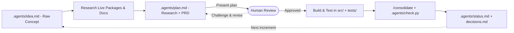

# AI-Native Project Harness

<!-- ABOUT THIS TEMPLATE — template landing page. Replaced with project-specific docs during /bootstrap or the Documentation Phase. -->

A lightweight, portable **AI-Native Project Harness** for building clean software with coding agents — without context rot, scope creep, or vendor lock-in.

All harness files (state, modular rules, on-demand skills, runtime guardrails, and quality gates) live inside [`.agents/`](.agents/), keeping your project root clean whether you start a **new repository**, drop into a **monorepo subfolder**, or spin up a **plain local folder without Git**.

---

## What It Works With

* **Any Coding Agent (Switchable Mid-Project):**
  * **Claude Code** (`CLAUDE.md` -> `AGENTS.md`, plus `.claude/{settings.json, rules, skills}`)
  * **Antigravity** (`agy` CLI & IDE extension — native `AGENTS.md` + `.agents/{rules, skills, hooks.json}`)
  * **Cursor, Windsurf, Codex, & Copilot** (`AGENTS.md`)
* **Any Workspace Shape:** Standalone GitHub repo, monorepo cell (tracked or local-only), or a plain non-Git directory.
* **Stack Defaults (Customizable via `/bootstrap`):** Python 3.11+ managed strictly with [`uv`](https://docs.astral.sh/uv/) (`ruff`, strict `mypy`, `pytest`), plus modular rules for Google Cloud (ADC-only) and Jupyter notebooks that you can keep, prune, or extend per project.

---

## How the Workflow Iterates

Instead of jumping straight from a vague prompt into sprawling code, the harness enforces an **iterative loop** where you and the agent sharpen a verified plan *before* building, and consolidate project memory *after* every increment:



---

## Getting Started (Step-by-Step)

### 1. Copy or Clone Into Your Workspace

Pick whichever fits how you want to work:

* **Option A · New GitHub repository (UI or `gh` CLI):**
  Click **"Use this template" -> "Create a new repository"** on GitHub, or run:
  ```bash
  gh repo create <your-new-repo> --template statmike/agent-repo-template --private --clone
  cd <your-new-repo>
  ```
* **Option B · Plain local folder (no Git required):**
  Copy with `rsync -a` (or `cp -a`) so symlinks stay intact:
  ```bash
  rsync -a --exclude='.git' --exclude='.github' --exclude='.venv' \
    /path/to/agent-repo-template/ /path/to/your-project/
  cd /path/to/your-project
  ```
* **Option C · Subfolder inside an existing monorepo:**
  ```bash
  git clone https://github.com/statmike/agent-repo-template <monorepo>/path/to/cell
  rm -rf <monorepo>/path/to/cell/.git <monorepo>/path/to/cell/.github
  cd <monorepo>/path/to/cell
  ```
  *(Want the harness kept purely local and untracked in the monorepo? `/bootstrap` will add `.agents/`, `.claude/`, `AGENTS.md`, and `CLAUDE.md` to `.gitignore` for you.)*

---

### 2. Initialize With `/bootstrap`

Open your preferred agent (`claude`, `agy`, Cursor, IDE chat) **inside the project folder** and run `/bootstrap` (or prompt: *"Bootstrap this project"*).

The [`bootstrap`](.agents/skills/bootstrap/SKILL.md) skill interviews you first (proposing smart defaults from your folder name and Git state), then configures the workspace in one pass:
* **Asks for your project name, one-line description, workspace mode, stack rules, and license choice** before changing any files.
* Updates `pyproject.toml` and replaces this template `README.md` with a clean starter README for your new project.
* Prunes unused domain rules (for example removing `gcp.md`, `notebooks.md`, or the Python scaffold if building a non-Python project).
* Runs `uv sync`, verifies a green baseline via `uv run python .agents/check.py`, and **prompts you to drop your rough concept into [`.agents/idea.md`](.agents/idea.md)** (or share it right in chat) to kick off planning.

---

### 3. Iterate Your Rough Idea Into a Verified Plan (Before Building)

1. **Dump your raw concept into [`.agents/idea.md`](.agents/idea.md):**
   Select-all and paste whatever you have — rough bullet points, half-formed goals, constraints, or notes from an earlier brainstorm. Don't worry about polishing formatting or looking up exact package APIs. *(Prefer starting in chat? Describe your idea conversationally and ask the agent to capture it in `.agents/idea.md`.)*

2. **Kick off Research & Planning:**
   Prompt your agent:
   > Read `.agents/idea.md`, verify current packages and docs, and draft `.agents/plan.md`.

   Before proposing a design, the agent **verifies ground truth** — inspecting installed packages (`uv run python -c ...`), testing candidate libraries ephemerally (`uv run --with <pkg> ...` without touching `pyproject.toml`), and checking current docs. It writes `## Research Findings` (calling out stale assumptions or simpler native approaches) and `## Design` (PRD + Mermaid diagrams) into [`.agents/plan.md`](.agents/plan.md), then **stops at the Approval Gate**.

3. **Iterate on [`.agents/plan.md`](.agents/plan.md) until it's right:**
   Treat `.agents/plan.md` as a shared workbench before any application code is written:
   * Push back in chat (*"keep this in one module instead of three"*, *"compare library X vs Y"*, *"drop the caching layer for v1"*).
   * Or edit `.agents/plan.md` directly in your editor and tell the agent to reconcile the design with your edits.
   * Repeat as many rounds as needed — the agent will not write code in `src/` or `uv add` dependencies until you explicitly approve the plan:
     > Approved — go ahead and build `.agents/plan.md`.

---

### 4. Work & Iterate Across Any Agent (Day 2 and Beyond)

Chat transcripts are machine-local and ephemeral; **`.agents/` is your durable memory**:

* **Resume cold or switch agents freely:** Close Claude Code mid-project, open Antigravity (or move to another machine), and say:
  > Orient yourself and tell me where we stand.

  Every session starts with **Orientation** (`AGENTS.md` Step 0): the agent reads [`.agents/status.md`](.agents/status.md), [`.agents/decisions.md`](.agents/decisions.md) (so it never re-litigates *"we already tried X and it failed because Y"*), and [`.agents/rules/`](.agents/rules/), reconciles them against `git status` or the filesystem, and states where things stand in 2–4 lines before acting.

* **Close every increment with `/consolidate`:**
  When a feature works, run `/consolidate` (or ask the agent to run the Consolidation Phase). It harvests architectural decisions into `.agents/decisions.md`, moves deferred ideas into `.agents/status.md`, sweeps `TODO`s and dead code, refreshes any affected notebook outputs, and runs `uv run python .agents/check.py`.

* **Start the next increment the same way:**
  Paste the next feature's rough concept into `.agents/idea.md` (or promote an item from *Next* / *Later* in `.agents/status.md`), iterate on `.agents/plan.md`, approve, build, and `/consolidate`.

---

## What Lives in the Harness

```text
.
├── AGENTS.md                       # Master workflow directive (CLAUDE.md symlinked)
├── .agents/
│   ├── README.md                   # Deep-dive customization & personal toolkit guide
│   ├── idea.md                     # Human paste-pad for raw concepts & brainstorms
│   ├── plan.md                     # Researched PRD + Mermaid architecture (approval-gated)
│   ├── status.md                   # Evergreen snapshot: Current State, Now, Next, Later, Gaps
│   ├── decisions.md                # Append-only Architecture Decision Records (YYYY-MM-DD)
│   ├── check.py                    # Universal local + CI quality & doctrine gate
│   ├── hooks.json & hooks/         # Polyglot PreToolUse guards (uv enforcement & secret blocking)
│   ├── rules/                      # Auto-loaded modular rules (python.md, gcp.md, notebooks.md)
│   └── skills/                     # On-demand skills (bootstrap, consolidate, + your own)
└── .claude/                        # Symlink bridge (.claude/{rules,skills} -> ../.agents/...)
```

For adding **project-specific rules and skills**, sharing **personal skills across Claude Code and Antigravity**, and configuring **monorepo cells**, see **[`.agents/README.md`](.agents/README.md)**.

## License

Released under the [Apache License 2.0](LICENSE).
